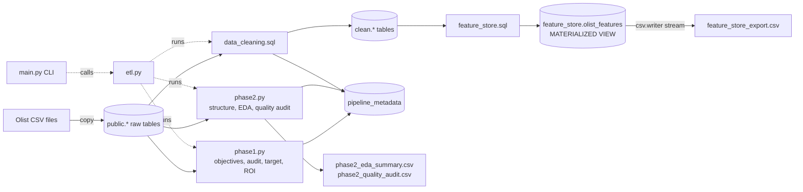

# Olist Delivery-Delay Feature Store (PostgreSQL + psycopg2)

**DEPI - Databases and SQL for Data Science · Capstone Mini-Project**
Domain: E-commerce logistics (**Option A - Olist**) · Target: `is_late_delivery`

A SQL-first pipeline that turns the raw Olist relational database (with real-world defects) into a
clean, leakage-aware **Feature Store** for predicting whether an order will arrive after its
estimated delivery date. The work follows **CRISP-DM** (Business Understanding -> Data Understanding
-> Data Preparation).

> **Anti-Pandas mandate.** Pandas, Polars and any DataFrame library are **not used**. Every audit,
> cleaning step and feature is computed inside PostgreSQL. Python (`psycopg2`) only orchestrates
> connections, transactions and streams result sets to CSV with the built-in `csv` module.

---

## Architecture



## Repository structure

```
depi-sql-capstone-<student_id>/
├── README.md
├── requirements.txt
├── config.py              # env loading, psycopg2 connection pool, small shared helpers
├── main.py                # interactive CLI  (--phase N | --all)
├── etl.py                 # master orchestrator: phase1 -> phase2 -> phase3
├── notebooks/
│   ├── 01_eda_scratchpad.ipynb
│   └── 02_feature_engineering_test.ipynb
├── scripts/
│   ├── phase1.py          # Business Understanding + metadata logging
│   ├── phase2.py          # Data Understanding: structural audit, EDA, quality audit
│   └── phase3.py          # Data Preparation: cleaning, features, Feature Store, export
├── sql/
│   ├── audit_queries.sql  # baseline counts, EDA statistics, quality audit
│   ├── data_cleaning.sql  # dedup, imputation, outlier capping, cohort flag
│   └── feature_store.sql  # MATERIALIZED VIEW + PL/pgSQL refresh + validations
└── outputs/
    ├── phase2_eda_summary.csv
    ├── phase2_quality_audit.csv
    └── feature_store_export.csv
```

SQL files are split into **named blocks** (`-- name: block_name`) which `config.load_queries()` reads,
so every statement lives in `.sql` files and Python never builds SQL by hand.

## Setup

**Requirements:** Python 3.10+, PostgreSQL 14+ (developed against 18), `git`.

### 1. Install dependencies
```bash
python -m venv .venv
.venv\Scripts\activate          # Windows   (Linux/macOS: source .venv/bin/activate)
pip install -r requirements.txt
```

### 2. Load the Olist dataset into PostgreSQL
Download the *Brazilian E-Commerce Public Dataset by Olist* from
[Kaggle](https://www.kaggle.com/datasets/olistbr/brazilian-ecommerce) and extract the 9 CSV files
(for example to `D:/olist/`). Then create the database and the raw tables:

```sql
CREATE DATABASE olist_db;     -- run on the "postgres" database, then connect to olist_db
```

```sql
CREATE TABLE customers (customer_id TEXT, customer_unique_id TEXT,
    customer_zip_code_prefix TEXT, customer_city TEXT, customer_state TEXT);
CREATE TABLE geolocation (geolocation_zip_code_prefix TEXT, geolocation_lat DOUBLE PRECISION,
    geolocation_lng DOUBLE PRECISION, geolocation_city TEXT, geolocation_state TEXT);
CREATE TABLE orders (order_id TEXT, customer_id TEXT, order_status TEXT,
    order_purchase_timestamp TIMESTAMP, order_approved_at TIMESTAMP,
    order_delivered_carrier_date TIMESTAMP, order_delivered_customer_date TIMESTAMP,
    order_estimated_delivery_date TIMESTAMP);
CREATE TABLE order_items (order_id TEXT, order_item_id INT, product_id TEXT, seller_id TEXT,
    shipping_limit_date TIMESTAMP, price NUMERIC(10,2), freight_value NUMERIC(10,2));
CREATE TABLE order_payments (order_id TEXT, payment_sequential INT, payment_type TEXT,
    payment_installments INT, payment_value NUMERIC(10,2));
CREATE TABLE order_reviews (review_id TEXT, order_id TEXT, review_score INT,
    review_comment_title TEXT, review_comment_message TEXT,
    review_creation_date TIMESTAMP, review_answer_timestamp TIMESTAMP);
CREATE TABLE products (product_id TEXT, product_category_name TEXT, product_name_lenght INT,
    product_description_lenght INT, product_photos_qty INT, product_weight_g INT,
    product_length_cm INT, product_height_cm INT, product_width_cm INT);
CREATE TABLE sellers (seller_id TEXT, seller_zip_code_prefix TEXT, seller_city TEXT, seller_state TEXT);
CREATE TABLE product_category_name_translation (product_category_name TEXT,
    product_category_name_english TEXT);
```

Load the files from `psql` (client-side `\copy`, so no server file permissions are needed):

```
\copy customers FROM 'D:/olist/olist_customers_dataset.csv' CSV HEADER
\copy geolocation FROM 'D:/olist/olist_geolocation_dataset.csv' CSV HEADER
\copy orders FROM 'D:/olist/olist_orders_dataset.csv' CSV HEADER
\copy order_items FROM 'D:/olist/olist_order_items_dataset.csv' CSV HEADER
\copy order_payments FROM 'D:/olist/olist_order_payments_dataset.csv' CSV HEADER
\copy order_reviews FROM 'D:/olist/olist_order_reviews_dataset.csv' CSV HEADER
\copy products FROM 'D:/olist/olist_products_dataset.csv' CSV HEADER
\copy sellers FROM 'D:/olist/olist_sellers_dataset.csv' CSV HEADER
\copy product_category_name_translation FROM 'D:/olist/product_category_name_translation.csv' CSV HEADER
```

Expected row counts: customers = orders = 99,441 · order_items 112,650 · order_payments 103,886 ·
order_reviews 99,224 · products 32,951 · sellers 3,095 · geolocation 1,000,163 · translation 71.

> The raw tables intentionally have **no primary / foreign keys**, mirroring a raw operational load.
> Keys are enforced on the cleaned tables in the `clean` schema.

### 3. Configure the connection
```bash
copy .env.example .env      # Linux/macOS: cp .env.example .env
```
Edit `.env` (`DB_HOST`, `DB_PORT`, `DB_NAME`, `DB_USER`, `DB_PASSWORD`). `.env` is git-ignored.

## Usage

```bash
python main.py --all        # full pipeline: phase 1 -> 2 -> 3
python main.py --phase 1    # Business Understanding only
python main.py --phase 2    # Data Understanding only (writes the two audit CSVs)
python main.py --phase 3    # Data Preparation only (builds clean.* + Feature Store + export)
python main.py              # interactive menu
```

Every phase is **idempotent** (clean tables are dropped and rebuilt; metadata is replaced), and
`phase3` runs in a single transaction: any error rolls everything back.

Inspect the run log inside PostgreSQL:
```sql
SELECT phase, category, item, detail FROM pipeline_metadata ORDER BY id;
```

## CRISP-DM walkthrough

### Phase 1 - Business Understanding
| Checklist item | Implementation |
|---|---|
| Define objectives | Business, ML, database and pipeline goals logged by `phase1.py` |
| Resource audit | Exact row count + declared PK/FK count per table; execution schedule of the 3 phases |
| Target definition | `is_late_delivery = 1` if `order_delivered_customer_date > order_estimated_delivery_date`, else `0`; baseline counts measured in SQL |
| ROI framework | 0 duplicate orders, 0 NULLs in the Feature Store, 0 Pandas/Polars imports, re-runnable pipeline |

### Phase 2 - Data Understanding
* **Structural audit** - columns, datatypes, declared foreign keys (none in the raw load) and baseline
  row counts for every table, logged to `pipeline_metadata`. The baseline counts are compared with
  post-transformation volumes in phase 3 (`volume_check`).
* **EDA via SQL** - `COUNT / MIN / MAX / AVG / STDDEV / MEDIAN` (`PERCENTILE_CONT(0.5)`) for numeric
  columns plus derived delivery metrics -> `outputs/phase2_eda_summary.csv`.
* **Quality verification** - a defect log -> `outputs/phase2_quality_audit.csv` with: missing /
  empty values, duplicate keys, IQR outliers, impossible timestamps and status contradictions,
  orphan foreign keys, unexpected categorical values and **regex checks** (`column ~ 'pattern'`)
  for ID format, state codes, zip codes, city text and whitespace-only comments.

### Phase 3 - Data Preparation
| Requirement | How it is done (in SQL) |
|---|---|
| Cohort filtering | `clean.orders.in_cohort` = delivered, with real delivery + estimated dates, delivery not before purchase. Orders with no delivery date are **excluded** - the target is undefined for them and labelling them `0` would bias the model. `HAVING SUM(price) > 0` drops orders without valid items |
| Deduplication | `ROW_NUMBER() OVER (PARTITION BY key ORDER BY ...)` on every table; primary keys are then added to the clean tables (a failed dedup would error out) |
| Imputation | `COALESCE` / `CASE WHEN`; product attributes by **category average** (`AVG() OVER (PARTITION BY category)`), then global average; Feature Store gaps filled with `AVG() OVER ()` |
| Outlier handling | Winsorisation with `PERCENTILE_CONT` (p99 for price, freight and payment value; p01 - p99 for product weight / dimensions); impossible coordinates filtered by Brazil's bounding box |
| Recency / frequency / monetary | `customer_prior_orders`, `days_since_prev_order` (`LAG`), `customer_tenure_months` (`AGE`, `DATE_PART`), `customer_prior_spend` |
| Cumulative / rolling / lagged | `SUM() OVER`, `COUNT() OVER`, 3-order rolling average, 30-day rolling seller load (`RANGE BETWEEN INTERVAL '30 days' PRECEDING AND INTERVAL '1 second' PRECEDING`) |
| High-cardinality reduction | ~70 product categories -> 8 groups, 27 states -> 5 regions with `CASE WHEN` |
| Seller location metrics | Seller region, same-state flag, haversine seller-customer distance from zip-prefix centroids |
| Dataset packaging | `MATERIALIZED VIEW feature_store.olist_features` + PL/pgSQL function `feature_store.refresh_feature_store()` |
| Extraction | `csv.writer` streaming a server-side cursor -> `outputs/feature_store_export.csv` |

### Data leakage design
* History features use frames ending at `1 PRECEDING`, so an order never sees itself or later orders.
* **Review data is deliberately not used** - reviews are written after delivery.
* Columns prefixed `leak_` are derived from the actual delivery date. They exist for analysis
  (the assignment asks for delivery timestamp deltas) and **must be excluded from model inputs**.
* `approval_hours` and `carrier_handover_days` are only known after approval / hand-over to the
  carrier: use them only if predictions are made at shipping time.

## Feature Store data dictionary (`feature_store.olist_features`)

One row per delivered order (primary key `order_id`).

| # | Column | Type | Group | Description / transformation |
|---|---|---|---|---|
| 1 | `order_id` | TEXT | key | Unique order identifier (deduplicated) |
| 2 | `customer_unique_id` | TEXT | key | Real customer identity (`customer_id` changes per order) |
| 3 | `is_late_delivery` | SMALLINT | **target** | `1` if delivered after the estimated date, else `0` |
| 4 | `purchase_year` | SMALLINT | purchase | `DATE_PART('year', purchase timestamp)` |
| 5 | `purchase_month` | SMALLINT | purchase | `DATE_PART('month', ...)` |
| 6 | `purchase_dow` | SMALLINT | purchase | ISO day of week (1 = Mon ... 7 = Sun) via `EXTRACT(ISODOW ...)` |
| 7 | `purchase_hour` | SMALLINT | purchase | Hour of purchase (0-23) |
| 8 | `is_weekend` | SMALLINT | purchase | `1` if Saturday or Sunday |
| 9 | `is_holiday_season` | SMALLINT | purchase | `1` if purchase month is November or December |
| 10 | `estimated_delivery_days` | NUMERIC(8,2) | purchase | Estimated delivery date minus purchase time, in days |
| 11 | `item_count` | INT | purchase | Number of items in the order |
| 12 | `seller_count` | INT | purchase | Distinct sellers in the order |
| 13 | `product_count` | INT | purchase | Distinct products in the order |
| 14 | `items_value` | NUMERIC(12,2) | purchase | Sum of item prices (winsorised at p99) |
| 15 | `freight_total` | NUMERIC(12,2) | purchase | Sum of freight values (missing -> 0, winsorised at p99) |
| 16 | `freight_ratio` | NUMERIC(8,4) | purchase | `freight_total / items_value` |
| 17 | `avg_item_price` | NUMERIC(12,2) | purchase | Mean item price |
| 18 | `max_item_price` | NUMERIC(12,2) | purchase | Highest item price |
| 19 | `total_weight_g` | NUMERIC(12,2) | purchase | Sum of product weights (imputed by category / global average, winsorised); remaining gaps filled with the cohort average |
| 20 | `total_volume_cm3` | NUMERIC(14,2) | purchase | Sum of length x height x width (cleaned dimensions) |
| 21 | `payment_value_total` | NUMERIC(12,2) | purchase | Sum of payments; if no payment row, `items_value + freight_total` |
| 22 | `max_installments` | INT | purchase | Highest number of installments (missing -> 1) |
| 23 | `payment_methods_count` | INT | purchase | Distinct payment methods used (missing -> 0) |
| 24 | `main_payment_type` | TEXT | purchase | Payment type with the largest value (missing -> `unknown`) |
| 25 | `product_category_group` | TEXT | purchase | Primary product's category bucketed into 8 groups with `CASE WHEN` + regex |
| 26 | `customer_region` | TEXT | purchase | Customer state mapped to one of 5 Brazilian regions (`unknown` otherwise) |
| 27 | `seller_region` | TEXT | purchase | Primary seller's state mapped to a region |
| 28 | `is_same_state` | SMALLINT | purchase | `1` if customer and seller are in the same state |
| 29 | `seller_customer_distance_km` | NUMERIC(8,2) | purchase | Haversine distance between zip-prefix centroids; missing coordinates filled with the cohort average |
| 30 | `customer_prior_orders` | INT | purchase | Orders placed earlier by the same customer (`COUNT() OVER`, frame ends 1 row before) |
| 31 | `is_first_order` | SMALLINT | purchase | `1` if `customer_prior_orders = 0` |
| 32 | `customer_prior_spend` | NUMERIC(14,2) | purchase | Cumulative value of the customer's earlier orders |
| 33 | `days_since_prev_order` | NUMERIC(10,2) | purchase | Days since the customer's previous order (`LAG`); first order -> 0 (see `is_first_order`) |
| 34 | `customer_tenure_months` | INT | purchase | Months between the customer's first order and this one (`AGE`, `DATE_PART`) |
| 35 | `customer_rolling_avg_value_3` | NUMERIC(12,2) | purchase | Average value of the previous 3 orders; falls back to the current order value |
| 36 | `seller_prior_orders` | INT | purchase | Orders handled earlier by the primary seller (seller experience) |
| 37 | `seller_orders_prev_30d` | INT | purchase | Seller orders in the 30 days before this purchase (rolling workload) |
| 38 | `approval_hours` | NUMERIC(10,2) | shipping | Hours from purchase to approval (invalid -> NULL -> cohort average) |
| 39 | `carrier_handover_days` | NUMERIC(8,2) | shipping | Days from purchase to hand-over to the carrier (invalid -> cohort average) |
| 40 | `leak_actual_delivery_days` | NUMERIC(8,2) | **leakage** | Actual delivery time in days - **do not use as a feature** |
| 41 | `leak_delay_days` | NUMERIC(8,2) | **leakage** | Delivered minus estimated date in days - **do not use as a feature** |

## Anti-Pandas compliance
* `requirements.txt` contains only `psycopg2-binary`, `python-dotenv` and `jupyter`.
* No `import pandas` / `import polars` anywhere (notebooks print query results with plain Python).
* CSVs are written with the built-in `csv` module from a server-side cursor (constant memory).

## Troubleshooting
| Symptom | Fix |
|---|---|
| `connection refused` / wrong port | Check `DB_PORT` in `.env` (PostgreSQL 18 may use 5433 when other versions are installed) |
| `relation "orders" does not exist` | The raw tables are missing or `DB_NAME` points to another database |
| Row counts one higher than expected | The CSV header was loaded as data - reload with `CSV HEADER` |
| `permission denied` while loading CSVs | Use psql `\copy` (client side) instead of server-side `COPY` |
